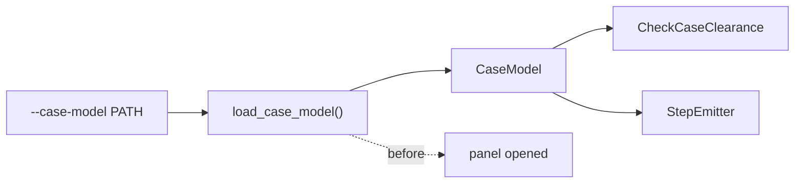

# ADR-0007: Case models and clearance

**Status:** Accepted, with the optional `stompdrill[step]` extra superseded by
[ADR-0009](0009-shared-model-package-and-dependency-order.md). The kernel is now
`stompgeom`'s unconditional dependency and reaches `stompdrill` through it. A
later amendment adds a second cutting pass, over the walls the same model lets
a run discover, and pairs a wall's inner surface without a companion step. A
further amendment decides which wall a component's hole goes in: where both
signs of its axis reach a wall, the sign nearer its own tip carries the hole; the
diameter is measured from the feature's tip to the wall's outer face; and both
multi-wall refusals are findings rather than raises. A wall that already takes a
hole for one component at a place refuses a second component's hole there as a
finding, because no earlier stage can see two wall holes at once. A further
amendment gives a wall its own rule for finding the surface behind it, and has
the model say why it holds no walls. A final amendment derives the tolerance of
the guard that confirms a stated depth names a wall region's own plane from two
roundings the frame carries -- its direction's, which is a lever arm about the
wall's own datum, and its canonical lengths', which is a constant -- rather
than fixing it. Three further amendments record what the wall pass actually
does: that a hole is measured along its component's axis while the cut in the
emitted model runs along the wall's normal, a divergence left in place; what a
wall's datum, a wall hole's span and the geometry additions are; and that a
wall pairs with its inner face on the axis that face leans on and on drafting
no more than it does, which replaces the near-parallel angle and the thickness
cap with an exact equality and an inequality whose two sides the casting itself
supplies.

This ADR retains the original extra decision and its rationale as history. The
current installation, the later frame and protocol amendments, and the wall
amendment are described below. The remaining decisions still apply.

## Context

`stompdrill` decides where holes go. At the time of this decision, it neither
showed the drilled enclosure nor checked whether the holes could be drilled.

Hammond distributes STEP models of its 1590-series enclosures. One parsed model
can support both tasks: a `StepEmitter` cuts the drilled part, and a
`CheckCaseClearance` stage checks whether each hole lands on drillable metal.
Both read the same `CaseModel`.

The existing ADRs did not cover an emitter reading geometry outside `DrillData`,
an optional runtime dependency, or byte identity delegated to a third-party
kernel. This decision established those boundaries before implementation.

## Decision

### Supply and load the enclosure model once

Enclosure geometry enters only as a supplied model. `stompdrill` never
synthesises an enclosure. `--case-model PATH` names a Hammond STEP file the
operator already has. The package reads it to verify clearance and cut the
holes it has already decided on. Acquiring the file is outside the package's
scope: `tools/fetch_case_model.py` is a stopgap downloader outside the distributed
package, with `stompcad` named as its successor.

**Amended.** The succession has happened. `stompcad` owns acquisition: it keeps
an XDG-located cache keyed by part designator, fetches a missing model from the
manufacturer, and hands `stompdrill` the cached path like any other. The stopgap
script is gone rather than kept beside it, since two downloaders would be two
answers to where a model comes from. Nothing about this package changes: it is
still handed a path, still verifies the model it is given, and still refuses to
synthesise an enclosure.

`--case-model` resolves before the panel is opened, alongside the other flags.
An unreadable model, a model with no recognisable enclosure, or one with no
drillable face is a usage error. The parsed `CaseModel` is built once and feeds
both consumers, following ADR-0001's rule that shared facts are computed before
the emitter fan-out. ADR-0007, Figure 1 shows that flow.

**Amended.** The model is now read for two cutting passes, not one: the
panel's plate holes as before, then the holes a seating puts in its walls,
which the amendment below finds by lateral projection over this same parsed
model.

*Figure 1: one case-model load supplies clearance checking and STEP emission.*

### Use one pinned geometry kernel

The original decision put `cadquery-ocp==7.9.3.1.1` in an optional
`stompdrill[step]` extra, leaving the base dependencies at `pikepdf>=9`.
`CheckCaseClearance` required that extra even when no STEP artefact was requested.
Cutting a valid solid and round-tripping an XCAF assembly required a kernel;
using it for clearance too avoided a second implementation of the same geometry
rules.

The protocol in `cad/base.py` was pure Python, so `import stompdrill` did not
import the kernel. The OCP implementations in `cad/step.py`, `cad/case.py`,
`cad/region.py` and `cad/loader.py` were imported lazily.

**Amended:** the extra is retired. `cadquery-ocp==7.9.3.1.1` is now an
unconditional dependency of `stompgeom`, so a plain install includes support for
`--case-model` and `--emit step=…`. The exact pin and the single geometry
implementation remain. `cad/base.py` still defines `CaseModel` in pure Python,
and `import stompdrill` still does not import the kernel. `cad/step.py` has been
replaced by `stompgeom.step`.

### Check clearance in the pipeline

`CheckCaseClearance` runs in the `Pipeline` alongside `Deduplicate`,
`ReviewGridTies`, `RouteHoles` and `CheckOutlineContainment`. Its diagnostics are
shared facts under ADR-0001: every artefact from an invocation must agree about
which holes are drillable. Checking only inside `StepEmitter` could let its
answer disagree with a drawing and would omit clearance diagnostics whenever no
STEP output was requested.

### Preserve geometry and appearance

Identical inputs must produce a geometrically and visually identical model.
Byte comparison is the preferred way to enforce that guarantee. A third-party
kernel writes the STEP bytes, so the guarantee needs an explicit scope.

To make bytes deterministic, pin `cadquery-ocp` exactly, copy
`FILE_NAME.time_stamp` from the source model, order cut tools by `Hole.index`,
and canonicalise the kernel's non-deterministic output. That currently includes
the translator's instance counter, assembly-occurrence names and colour chains.
The colour-chain order comes from pointer-hashed maps rebuilt on every write.
Byte identity across kernel versions is a non-goal.

Two exceptions govern byte comparison:

- Environment-derived metadata, such as timestamps, user and host names,
  absolute paths and random identifiers, is pinned to deterministic values
  where possible. Where this is impossible, exclude it from byte comparison and
  record the reason at the exclusion. This metadata describes the machine and
  must not affect the panel's geometry or appearance.
- Where byte identity is unreachable, tests must compare the underlying
  properties: the same solids and geometry, the same product names, and the same
  colours on the same parts. A semantically empty byte change must not cause the
  geometry or appearance check to be weakened or deleted.

The drilled solid's colour has a further exemption, discovered during
implementation and described under Consequences.

### Check the flat inner face's boundary

A hole is legal exactly when its footprint lies inside the flat inner face's
outer boundary eroded by `--case-margin`. Hammond plates are flat. For a
die-cast flat face, that outer boundary follows nominal wall thickness; bosses,
ribs and fillets are not nominal features and do not belong to it.

This is a permanent specialisation for die-cast enclosures. It builds one region
per model and tests containment per hole, avoiding a boolean intersection with
the full assembly for every hole. It does not cover an enclosure whose drilled
face is not flat.

### Register the inner surface as the frame datum

**Amended:** `build_frame` places `basis.origin_nm` on the flat face opposite
the drilled face: the inner surface against which a seated board rests.
`FaceFrame` documents this convention so a consumer with only `stompmodel`
installed can interpret the frame. The choice cannot be recovered from the
frame's values alone.

This datum does not change clearance verdicts. `cad.region.contains` and
`clearance_reason` project a canonical point and then replace its drill-axis
coordinate with the region's measured plane. The cutter, however, must start at
the drilled surface and pass through the plate. It therefore reads that plane
explicitly from the model instead of using the frame origin, following the same
explicit-plane approach as `cad.region`.

### Publish the checked registration

**Amended:** `CheckCaseClearance` reconciles the panel's drawn orientation with
the model's frame once. It is the stage that has both the enclosure
identification, available after quantisation, and the loaded model's frame,
available before it. It publishes the reconciled `FaceFrame` and drilled face
together as `DrillData.case`.

`StepEmitter` reads its frame and face from this checked registration. It must
not read `model.frame`/`model.face` directly and refuses with a typed error if no
registration is present. ADR-0007, Figure 1 still describes the shared parsed
model; classification and cutting use the registration's frame.

The original orientation amendment used `EnclosureMatch.rotated`, which records
that the panel matched a catalogue footprint after a quarter turn. This alone
cannot relate the panel's canonical axes to the model's independently chosen
axes. It also cannot say which way the artwork was turned.

Both possible quarter turns are orthonormal and right-handed, preserve the
normal `w`, and differ by a half turn in the plane. Their direction is therefore
a stated convention: a rotated panel maps `u` onto the model's `v`, and `v` onto
the model's negated `u`. The origin and `w` are unchanged.

If the correspondence cannot be established because no enclosure was identified
or the identified footprint has equal dimensions, the run emits
`case-orientation-unverifiable` at WARNING. In the equal-dimension case,
`cad.case.build_frame`'s deterministic but arbitrary in-plane tie-break provides
no evidence for either correspondence. Like `case-model-unverified`, the
warning reports an unavailable check. Making it an error would refuse square
enclosures the tool currently supports.

**Amended (T15):** the panel's measured extents decide whether a quarter turn is
needed. `EnclosureMatch.rotated` only describes a transposition relative to the
catalogue's printed row, and Hammond does not always print the larger dimension
first: `1590LB` is listed as 50.55 × 50.60 mm.

`CheckCaseClearance` therefore compares the two extents of
`ReferenceOutline.raw`, preserved through quantisation. Canonical *x* registers
on the model's `u`, which `build_frame` assigns to the larger measured span,
exactly when the drawn width is the larger drawn extent. The convention for the
direction of the turn remains unchanged. If no enclosure was identified, no
outline reached the stage, or the two drawn extents are equal, the model's frame
is used unchanged.

There is a limit to this comparison. It uses the precision of the artwork and
assumes the model's larger in-plane span is the physical dimension the catalogue
lists as larger. `_cross_check` sorts both footprints descending before
comparing them, so it does not verify that correspondence. If the catalogue
dimensions differ by less than the identification's 1.5 mm per-axis slack, the
turn depends on a distinction identification did not have to resolve. No
diagnostic marks this case. In the shipped catalogue, it affects `1590LB` alone,
whose dimensions differ by 0.05 mm.

Tests of this premise are inconclusive for the physical part. A solid built from
the catalogue's 50.55 × 50.60 mm dimensions gets `u` on the 50.60 mm axis, as the
rule requires. The real cached `1590LB` model measures 50.6 mm on both axes, with
a difference of 0.0 at kernel precision. Its `u` follows the lower-indexed free
axis tie-break. The supplied model therefore cannot verify whether the
catalogue's 0.05 mm ranking matches the casting.

### Amendment: the case is cut in two passes, and walls are found by lateral projection

**Accepted.** One enclosure model, drilled in two passes of one pipeline: the panel's holes as
before, then the holes a seating puts in the walls. The same model carries both, and a run with
no second pass cuts exactly what it cuts now.

A **wall** is discovered, never declared. Keep the plate levels that are *lateral* — whose
outward normal lies nearer the plane perpendicular to the drill axis than the axis itself —
group those by the nearest signed kernel axis, and the extreme level along that axis is the
wall's outer surface. Its inner surface is then found by `_wall_inner_level` (see the lid
amendment at the end of this file, which governs that pairing; the plate-thickness and axis
amendments between them each replaced an earlier form of the rule and are superseded in their
turn): a wall's inner surface arrives in a *different* direction bin, because the draft tilts
the two oppositely, so `facing` over the whole lateral population would pair a wall with the
opposite wall's outer face instead.

**No companion step joins it**, which is where a wall parts company with the panel.
`_nearest_companion_level` is a flat plate's device: its only filter is that a face points the
same way, which a plate's whole-span population makes safe and a wall's narrower lateral one
does not. Measured over the seven cached models, it attaches unrelated recessed geometry to a
wall's inner surface on six of them. A wall's inner surface therefore carries only its own
coplanar patches, which can tighten the containment check a later stage runs against it but
never loosen it.

Projection rather than draft, because draft is a property of casting and not of the definition
of a wall: an undrafted enclosure still resolves under this rule. The 45° boundary is where
"lateral" and "axial" meet rather than a tolerance; `tools/measure_walls.py` prints the measured
populations, which sit at 1.150°–2.500° and exactly 90.000° over the nine parts its default mode
runs. Swept over every casting the cache holds, the lateral population reaches 3.000° — on the
1590CE, 1590DE, 1590EE, 1590X and 1590XX, none of them among those nine — so the claim to hold
is that the margin to the boundary is tens of degrees and not tenths, rather than that nothing
exceeds two and a half.

A wall hole is cut **along its component's own axis**, not normal to the wall. A jack's plug must
not bind, and a drafted wall would put a wall-normal hole up to 2.500° off the part it admits.
The opening on the outer surface is therefore a slight ellipse, major axis `d / cos θ` — 1.001 d
at 2.500°, under the drill standard's own granularity — and in exchange no draft allowance is
added to any diameter.

The clearance rules are unchanged, applied per wall: a hole whose circle leaves the wall's
drillable region is `hole-off-face`, and one fouling what stands behind that wall is
`hole-through-boss`.

### Amendment: a component's hole goes in the wall it is mounted at, sized from its tip

**Accepted.** An in-plane axis has two signs and both are measured, because neither is
known to point at a wall. Where both reach one, **the sign whose crossing is nearer its own
tip carries the hole** — distance along the ray, from the feature's tip to that wall's inner
plane. A through-wall component is mounted *at* the wall it passes through: a jack's sleeve
sits flush with or a few millimetres inside the inner face, so its own extremity is nearest
that wall, while the extremity facing the other way is most of the enclosure's width from
the wall behind it. An exact tie is refused rather than broken, because nothing geometric
separates the two and a tie-break on anything else would be this file's invention.

Picking the sign that carries material fails on a flush-mounted jack, whose sleeve may stop
at the inner face and leave both spans material-free; the bore cannot separate them because
it is one value shared by both signs; and a profile states no sentinel, since `radius_at`
answers zero both past a stack's last step and before its first. Proximity needs none of
those: it is a property of where the part *is*, not of what it is made of.

The required radius is measured over the whole run **from the feature's tip to the wall's
outer face**, not across the wall's own thickness. A part is assembled through a wall, so
everything between its tip and the far side of the wall must pass the hole; measuring the
thickness alone sizes a jack seated a few millimetres short from its bore instead of its
sleeve, and asks for a hole the sleeve cannot enter. A modelled nut is still excluded, because
a nut sits beyond the tip and so beyond the run. The bore remains a floor, never a
ceiling.

Both multi-wall refusals are **findings, not raises**. `DrillWalls` is appended after the
drill half's own commit, so an exception there abandons every other component's hole and
leaves artefacts already on disk. The corner ambiguity of one ray in two regions stays
outside what this version drills — the clause says so — but it says it as a finding.

### Amendment: the hole is measured along the part's axis and cut along the wall's normal

**Accepted.** The amendment above decides that a wall hole is cut along its component's own axis.
Where a hole is *measured*, that is exactly what happens: `pipeline.walls` casts the ray along the
component's axis, takes the wall the rule above selects, places the hole where that ray crosses
the wall's outer plane, and sizes it over the run from the part's tip to that plane. The cut in
the emitted model does not follow it. `emitters.step` starts the cylinder on the wall's outward
normal, offset by the recorded plate thickness and an overshoot, and runs it inward along that
same normal — because a surface's frame is all the document hands an emitter, and a frame states
one normal.

So the two differ by the wall's draft: 1.2500° on the 1590B and the 1590B2, 1.4000° on the 1590BS.
The model carries a bore normal to the wall where the measurement describes one inclined by that
much. This is a divergence from the intent, recorded as one, and not a second decision.

It is left in place because the error it puts in the artefact is smaller than what the artefact
is for. Across a wall's own plate, a draft of that size walks the far end of the bore under
0.1 mm from where the inclined cut would leave it — the worst over every cached casting is
0.098 mm, on the 1590BB's 2.248 mm plate at 2.500°, catalogued draft being as much as that and
not only the 1.250° and 1.400° named above. That is inside the drill standard's own granularity
and well inside what a builder opens out by hand; and the slight ellipse the amendment above
already accepts on the outer surface is the same geometry seen from the other side.

What the fix wants is a value, not a different emitter. A hole on a wall carries no axis of its
own in the document — `Hole` states a surface and a position in that surface's frame, and the axis
the ray was cast along is discarded once the position is computed. Restoring it means a placement
value that travels with the hole, which every emitter cuts along and which the clearance check and
the drawing can read too. That changes what a drill document says about a hole, so it belongs to
the amendment that introduces such a value rather than to a patch inside one emitter. Until that
lands, a reader comparing the measurement against the model should expect this difference and no
other.

## Rationale

### Alternatives to kernel clearance

Precomputing an obstruction map in the helper script would have kept
`stompdrill` dependency-free, but introduced another input that could become
inconsistent with the model. It would also sample a surface the B-rep can answer
exactly, while leaving the cutting implementation unresolved.

Measuring depth along the drill axis with one boolean per hole against the full
assembly was rejected for the box. All 76 spline faces of a real Hammond box
sit in the collision zone, requiring ray-vs-trimmed-NURBS work regardless of the
implementation. It also costs a boolean per hole instead of one region per
model. A baseline measured at the face centre was rejected because a central
rib could raise the baseline and let real collisions pass.

A pure-Python clearance backend was considered. It could parse and clip the two
planar faces, bounded by lines and circles, that define the flat-face play area.
The kernel was retained because `BRepClass_FaceClassifier` and
`BRepExtrema_DistShapeShape` answer containment and clearance against the actual
trimmed face. A hand-written implementation would tessellate arcs and need a
resolution parameter.

Originally, avoiding the `stompdrill[step]` extra was a possible reason to add a
pure-Python `cad` backend behind `CaseModel`. The extra's retirement removes
that reason, but the protocol still allows a clearance adapter that can run
without `stompgeom`.

### Keep cutting specific to the kernel model

`CaseModel` is the kernel-free clearance contract. Cutting is typed against
`OcpCaseModel`: `cut_shape` needs a live `TDocStd_Document` and runs
`BRepAlgoAPI_Cut`. A pure-Python backend cannot supply that document, so a
`CuttableCaseModel` protocol would have only one possible implementation.

The cutting path uses `OcpCaseModel` in `cut_shape`, `StepOptions.model`,
`OutputSettings.case_model`, `load_case_model`'s return type and the CLI's model
construction. `StepEmitter.__init__` refuses a missing or clearance-only model
with `EmitterError`, naming `--case-model` as the remedy. This catches the
unsupported model before `cut_shape` could access a member outside the
`CaseModel` contract and raise `AttributeError` during emission.

### Drive the check from the supplied model

Clearance checking belongs to `--case-model`, independent of `--emit`. A run
with a model and no STEP output must still report `hole-off-face` and the other
clearance diagnostics. Folding the check into `StepEmitter` would break that
requirement.

## Consequences

### Installation and imports

The original extra left `pip install stompdrill` unchanged. Running
`CheckCaseClearance` or `StepEmitter` without `stompdrill[step]` raised an error
naming the extra. `make_emitter` ran before the panel was opened, catching the
missing dependency before processing.

Every install now includes the kernel. `require_kernel` and `KernelUnavailable`
remain in `stompgeom.kernel` to report a broken environment; their hint names
the missing package. A kernel-free installation is no longer a supported choice.

The original optional extra cost more than the kernel's 62 MB wheel:
`cadquery-ocp` pulls in `vtk`, which pulls in `matplotlib`, although neither the
emitter nor the clearance stage uses them. Every install now carries that cost.
ADR-0009 accepted it when setting the workspace's dependency order, on the basis
that no one used a kernel-free configuration.

### Colour after cutting

The drilled solid's own colour cannot survive the cut through this kernel's
bindings. Reassigning colour through `XCAFDoc_ColorTool` after `SetShape`
replaces a label's geometry does not work at solid, component or per-face
granularity, either before or after `UpdateAssemblies`.
`STEPCAFControl_Writer` gives the replacement shape a synthesised wrapper
`PRODUCT` instead of reusing the original label's `PRODUCT_DEFINITION`, and
colour assignment cannot reach that new product.

Every untouched solid retains its colour. Only the one or two drilled faces
lose theirs, and the semantic-equivalence test records that exception.

### Public types and test boundaries

`CheckCaseClearance` and `load_case_model` are exported from
`packages/stompdrill/src/stompdrill/__init__.py`, following the rule for a new
stage or source. `StepEmitter` registers itself in `emitters/step.py`; it is not
exported from the root, because `import stompdrill` must not import 400 MB of
kernel.

**Amended:** the root also exports `OcpCaseModel`, the return type of
`load_case_model`. Without it, a consumer following the public signature reached
an `ImportError` suggesting `CaseModel`, which `StepEmitter.__init__` refuses.
The general rule, enforced by a test, is that every package-defined type named
in a root-exported signature must be reachable from the root. Values owned by
`stompmodel` are deliberately excluded under ADR-0009. Exporting `OcpCaseModel`
adds no kernel import: `stompdrill.cad` already imports `.loader`.

`CheckCaseClearance` depends only on `CaseModel`, so its rules can be tested with
a hand-built fake, just as emitters are tested with hand-built `DrillData`.
Kernel integration tests once skipped when the extra was absent. Those skips
are removed now that the kernel is unconditional; a missing kernel must fail.

**Amended:** `CaseModel` also declares `model_name`, identifying the supplied
file. `load_case_model` resolves it alongside `part`. Any other backend must
identify its source the same way, because the published drill document depends
on this value.

### Scope of the face check

An enclosure with a non-flat drilled face needs a new decision. The flat-face
specialisation is permanent.

Without a case model, the panel is still checked against its reference outline
and can produce `hole-outside-outline`, a warning under
[ADR-0002](0002-domain-quantisers.md). The model adds an error-level check against
the actual drilled face, beyond the published top view.

### Amendment: a wall pairs with its inner face by plate thickness, and a model says why it has no walls

**Accepted**, and its pairing rule superseded by the axis amendment below; its
second half, on why a model holds no walls, stands. `_inner_level` is correct for the drilled
face, whose two faces are parallel, and
stays so. A wall needs its own rule because its two faces need not be drafted alike: 1590BS
drafts a wall's outer face 1.400° and its inner 1.250°, planes 0.15° apart that share no direction
bin, so pairing on exact bin equality found no inner face and discovery found no walls. A
casting that drafts its faces differently is real, and the rule may not assume otherwise.

`_wall_inner_level` takes the back-facing levels within 0.5° of the outer plane (a true inner face
measures 0.000°–0.200° over all 37 catalogued parts) whose plate is no thicker than 12 mm, then
the nearest plane, then the largest area. Angle alone cannot discriminate: a box drafted alike on
both sides makes the opposite wall's outer face exactly parallel to this wall's. Plate thickness
can: a true inner face stands 1.500–9.597 mm behind its outer, and the opposite wall's outer face
starts at 14.819 mm. Over the 148 box walls, 144 choose the face they chose before, none differ,
and 1590BS's four are newly found.

The model also carries `walls_unavailable`, the reason wall discovery was attempted and refused;
the loader keeps swallowing the refusal, since a lid has no walls and wall drilling is opt-in.
`DrillWalls` reads it where no wall was reached: a model with no walls and a reason reports that
the enclosure has no walls to drill, and why; otherwise the finding blames the axis, as
before. The code stays `wall-feature-unreachable`.

### Amendment: a wall's on-plane guard is derived from the two roundings its frame carries

**Accepted.** `contains_at_depth` asks whether a point lies on the region it was handed before
classifying it against that region, because nothing else tells it that the depth a caller named is
that region's own plane, and the classifier takes any depth over the footprint as inside. The
tolerance for that question is derived from the frame rather than chosen, and it has two terms,
because two roundings separate the plane the frame states from the plane the kernel's faces lie on.

**A lever arm, from the direction's rounding.** A wall frame's `w` is a `Level.direction`, keyed to
whole millionths and renormalised ([ADR-0008](0008-workspace-and-shared-geometry-core.md)), so the
stated plane leans by up to `stompgeom.levels.direction_tilt` — `sqrt(3) / (2 x 10^6)`, 8.66e-7 rad.
The two planes cross at the wall's **own datum**, not near the model origin: `_wall_frame` puts
depth zero on the plane through the *midpoint* of the outer faces' projected `w`-range, so the plane
is centred on the face and the model-origin term cancels exactly. The law is therefore `off-plane =
c0 + sin(theta) x (v - v_datum)`, and the lever arm is a point's **in-plane** distance from the
region's own projected centre. Measured on the 1590B2 right wall: 0.729 nm at the datum, unchanged
at 0.729 nm across the whole `u` axis out to ±18.19 mm — while that point's distance from the model
origin moves from 58.16 to 60.94 mm — and 0.210 and 1.669 nm at `v = ±8.13 mm`, a lean of 8.97e-8
rad, a tenth of the bound. An origin-distance law predicts 50.37 nm at that datum, seventy times the
truth, and predicts a change along `u` that is not there.

`radius`, the farthest corner's norm, bounds that in-plane half-extent **unconditionally**: two
opposite corners satisfy `||c|| + ||c'|| >= ||c - c'||`, so the greater of them is at least half the
box diagonal, and a set's extent along any one direction never exceeds its own diameter. The bound
is therefore conservative for any model at any position — nothing about it assumes the geometry is
centred on the origin, and translating a model does not degrade it.

**A constant, from the canonical lengths' rounding.** `origin_nm`, `plate_nm` and `thickness_nm` are
whole nanometres ([ADR-0003](0003-quantisation-boundary-and-ordering.md)), so a correctly placed
point sits off the plane by up to `sqrt(3)/2 + 1/2`, 1.366 nm, **wherever it is**: up to half a
nanometre per axis in the origin, and half a nanometre in the offset along `w`. That is what the
0.729 nm measured at the 1590B2's datum is, where the lever arm is exactly zero. Across the 148
walls of the 37 catalogued parts the worst datum gap is 0.840 nm (1590N1), all of them under the
1.366 nm the rounding allows, and the quiet castings are dominated by it: the 1590A's worst gap is
0.615 nm in total.

The bound is therefore `direction_tilt() * radius + 1.366 nm`, still floored at the classifier's own
coincidence tolerance so that the two questions `cad.region` asks about one point cannot disagree —
a floor the constant now always clears, so it states that invariant rather than doing work. Over the
37 catalogued parts the sum measures 34–125 nm, against a worst gap of 12.5 nm for a point the
classifier calls inside with millimetres of boundary clearance; a caller naming the wrong plane is
out by a plate, 1.500–9.597 mm, which is eighteen thousand times the bound and up. The two scales
are four orders apart, so the guard keeps its whole value. `direction_tilt` is published beside
`direction_bin` for the reason that one is: a consumer measuring against a plane a level states owes
its tolerance to this rounding, and a second spelling of it would be a second chance to disagree
with the partition that created it.

The two terms are summed rather than collapsed into one floor. Neither alone states the error: a
fixed 2 nm is tighter than the 12.5 nm a correct point already measures on a large wall, and the arm
alone vanishes with the region — a wall region under roughly 1.6 mm across earns an arm below
1.366 nm and, under the old 0.1 nm floor, would have refused a hole for the very quantisation that
placed it. No catalogued wall is that small, the least being 37.81 mm of radius for 32.74 nm of arm,
so this is latent rather than live; it is fixed because the floor sat fourteen times under a
constant that is always present, and a refused wall hole is a builder told their part will not fit.

A wall's two faces are still placed by the one `plate_nm` along `w`, and that stands: over every
catalogued wall the frame's depth-zero plane lies on the inner region's own plane to within 3 nm,
because every catalogued wall's two faces measure 0.000°–0.200° of parallel. The pairing rule
bounds that angle by the drafts of the two faces rather than by a figure of its own — the
amendment below says how, and what rests on it. The inner region is the one place
the lever arm is not measured from a centre of its own — the datum is the *outer* region's
projected centre, and the lip offsets the two by about 2 mm — which that 3 nm measurement is what
covers. Where a wall's inner region does
differ from its outer is in extent — the lid's seating lip interrupts it about 2 mm inside the
outer face's own bound — and refusing a hole there is what `THROUGH_BOSS` is for.

No panel artefact moves. `CheckCaseClearance` uses `contains`, which reads its plane off a kernel
axis and asks no on-plane question at all; `tools/verify-lock.sh` is the check, under
[ADR-0011](0011-behaviour-lock-and-its-blind-spots.md).

### Amendment: a wall's datum, a wall hole's span, and the geometry both needed

**Accepted.** Three records of what the wall pass settled, each of which a reader of the code
would otherwise have to work out from the code.

**The `u`/`v` datum is the centre of the outer region's bounding box**, not the region's centroid.
The drilled plate centres on the reference outline because the artwork does, and that is what
makes a centroid meaningful there. A wall carries no artwork: nothing is drawn on it, nothing is
registered to it, and a builder marking one measures from its edges. A box's centre is what a
drawing dimensions from, it does not move with the patches a drafted face tessellates into, and
it is the point the on-plane law above is a lever arm about — a centroid would shift with the
patching and carry that law's origin with it.

**The required radius is measured over `(outer, max(inner, 0))`**: from the wall's outer face to
the part's tip, or to the inner face where the part reaches past it. The bore is the floor,
because a plug enters a bore however little material surrounds it there. The clamp to zero is
what keeps a part stopping short of the inner plane from being measured over a run that ends
behind its own tip. The stocked ceiling is applied on top and is no part of the measurement:
`required_radius_nm` answers what must pass and `stocked_diameter_nm` then bounds it upward
within the operator's selected standard, so a requirement the standard cannot meet is a refusal
rather than a quietly widened hole.

**The kernel work the pass needed went to `stompgeom`**, under ADR-0008's rule that a kernel
operation belongs to the shared package whatever asked for it first: `radial_bands`, which
reduces a profile to the bands a clearance query asks about; `direction_bin` and
`direction_tilt`, which publish the level partition's own key and the rounding that key carries;
and `Cylinder.is_normal_to`, which answers whether a bore runs along a given direction. One
addition stayed in `stompdrill`, because it is not a kernel operation but a choice about what to
cut: `_bore`'s wall branch bounds the cylinder by the wall's own recorded thickness and an
overshoot at each end, where the plate's branch bounds it by the two levels the clearance check
already found. A wall is drafted, so the plate's bounds would not describe a hole through it.

### Amendment: a wall pairs with its inner face on the axis it leans on and the draft it carries

**Accepted**, and its draft clause stands: the amendment after it withdrew that clause and the
one at the end of this file restores it, because the lid it was withdrawn over has no walls to
disprove it with — read the last amendment for the rule the code states. The rule deletes
`_NEAR_PARALLEL_DEGREES` and `_PLATE_MAX_NM`, and no number replaces either: what a wall's inner
face is turns out to be stated by the grouping that found the wall, and the bound this amendment
adds on top of that grouping is a comparison between one casting's own two faces.

**A wall's inner face is the nearest plate level behind its outer face that leans on the exactly
opposite signed kernel axis and drafts no more than the outer face does.** `nearest_axis` already
answers which signed axis a level leans on, and `_grouped_by_axis` already uses an equality on that
answer to tell one wall from another; the first clause is that equality read once more, from the
other side of one wall. No thickness, no area and no magnitude anyone chose enters either clause —
the second compares a candidate's draft against the outer face's own, so the casting supplies both
sides of it.

Both rules it replaces were wrong, and wrong differently.

**Exact direction-bin equality** assumed a wall's two faces are drafted alike. The 1590BS drafts
its outer face 1.400° and its inner 1.250°, planes 0.15° apart that share no bin, so on that
casting the rule found no inner face and discovery reported no walls at all. It remains correct
for the drilled plate, which really does have two parallel faces; that is why `_inner_level`
keeps it there and a wall no longer borrows it.

**A near-parallel angle and a thickness cap** replaced one wrong rule with two numbers chosen to
fit the catalogue we happen to hold. The cap states something about Hammond's present range and
nothing about what a wall is: a casting with a thicker wall would be refused for no reason a
reader could defend, and it decides nothing even here, because every rival further back than a
wall's own inner face — the opposite wall's outer face among them — is already excluded by
*nearest*. The angle is worse than redundant. It cannot discriminate in principle, since a box
drafted alike on both sides makes the opposite wall's outer face exactly parallel to this wall's;
and the case that defeats it is in the catalogue. On a casting whose four walls are the same
thickness, a *sibling* wall's inner face stands exactly as far behind this wall's outer face as
this wall's own inner face does, with exactly the same area and exactly the same draft. The
1590F, 1590K, 1590LLB, 1590Q, 1590U, 1590V and 1590Y each present such a face at a gap of zero
nanometres; the 1590KK presents one at 82–83 nm, the smallest non-zero gap in the catalogue.
Distance cannot separate them, an area tie-break cannot, and no angle rule of any kind can, because
the sibling's draft is the same number. The axis it leans on is the one thing that differs, which is
why the axis is what the rule *chooses* on. The angle that survives below chooses nothing: it is an
inequality between the two faces' own drafts, and its job is to bound the answer rather than to find
it.

The equality does the other half of the job too. Several castings put a level of some other axis
*nearer* a wall's outer face than that wall's own inner face is — a rib, a rim, or a sibling wall's
boss — by as little as 19.9 µm on the 1590CE and in as little as 0.203 mm² of sliver on the 1590B,
so *nearest* on its own would take one of those instead. Both ways of going wrong are one mistake: a
level leaning on some other axis is not this wall's inner face, however near it comes or however far
it stands.

`tools/measure_walls.py --inner-face` is the measurement. For every casting in the model cache and
each of its walls it prints the level the rule pairs with that wall beside the plate `find_walls`
records, both drafts the second clause compares, the next level on the wall's own axis, the nearest
level behind it leaning on any other axis with the gap between the two, and a `draft refused` row
for every level the second clause turns away. A wall the rule cannot answer prints `none` in place
of a plate, so a loss cannot read as a zero. The draft column comes from a named helper,
`level_draft`, because the arithmetic hides the quantity: tilt is measured *out of* the plane
perpendicular to the axis handed in, so against a level's own leaning axis it answers the complement
and a right angle less that complement is the draft. Run without arguments the mode sweeps the whole
cache. Every wall of every cached casting pairs with the face the plate-thickness rule chose, and
none is lost.

Two other candidates were measured and are not adopted. **The inner face drafting at least as much
as the outer** is false: the 1590BS drafts its inner face the less of the two, so that inequality
refuses the only inner face the 1590BS has, and on the castings above it admits the sibling. **The
inner face's own region containing the wall's datum** is true of every catalogued wall and loses
none, but it decides nothing the two clauses above do not — it excludes the same slivers and the
same siblings — and it costs a kernel bounding box per candidate to do it. It also fails to exclude
the one thing a reader might expect it to: the opposite wall's outer face spans this wall's datum
and is admitted by containment, and only *nearest* keeps it out.

**The draft clause is the bound, and the half-degree's real job was to be one.** Leaning on one
signed axis says nothing about how nearly the two planes are parallel: it admits anything inside a
quadrant, which is no statement a reader would defend about what a wall is. The inequality puts a
bound back and puts it in the casting's own currency. A candidate drafting no more than the outer
face does lies within the outer face's draft of the opposite axis, and the outer face lies within
its own draft of this one, so the two planes cannot diverge by more than those two drafts summed —
at worst twice the outer face's own, which measures 1.000°–2.500° over every cached casting, for a
bound of 2.000°–5.000°. (The narrower low end quoted elsewhere in this file is over the parts the
Evidence covers; this is over every casting the cache holds.) Weaker than half a degree, and not a
figure anyone chose: that is the trade this amendment makes.

That bound is what the consequence recorded above needs — a wall's two faces both placed by the one
`plate_nm` along `w`, with the frame's depth-zero plane on the inner region's own plane to within 3
nm. Every catalogued wall lands far inside it, because a real casting drafts its two faces the same
way out of the footprint plane and their divergence is then the *difference* of the two drafts
rather than their sum. That difference is what `--inner-face` prints both sides of, and it is zero
on every cached wall but the 1590BS's four, whose inner face drafts 0.150° less. The plane tilt the
earlier amendment quotes as 0.000°–0.200° is `_tilt_degrees` between the two planes, a different and
slightly looser measure of the same thing. The summed figure is what the clause permits, not what
any casting does.

**The clause refuses on most castings and decides on none, and that distinction is the whole of its
value.** `--inner-face` prints a `draft refused` row for every level it turns away, and over the
cached catalogue it turns away a great many: the levels leaning on a wall's own back axis include
chamfer flats, fillet lands and drafted pockets from 3.000° up to 44.912°, and one 1590BS wall turns
away nine of them. Not one refused level anywhere in the catalogue stands nearer the outer face than
that wall's own inner face does, so on no cached casting does the clause move an answer — the
`recorded` and `under the rule` columns agree on every wall, and a disagreement between them is what
a moved answer would look like. That agreement is a property of this catalogue rather than of the
clause: a casting putting a steeply drafted pocket nearer its outer face than its inner face would
have the axis equality take the pocket, and the inequality is what refuses it.

The on-plane guard stays what notices if the bound is ever not enough — a plane further from
parallel than the frame's own rounding allows puts a correctly placed point off it by more than the
guard's tolerance once there is any lever arm, so such a casting earns a refused wall hole rather
than a hole cut to a depth the document misstates. And the comparison itself needs no slack:
`direction_bin` renormalises every direction from an integer-millionths key, so a wall's two faces
carry mirrored keys and their drafts come out of identical arithmetic. Over the cached catalogue the
inner face's draft exceeds the outer's by exactly zero on every wall, so a bare `<=` refuses nothing
a tolerance would have admitted, and a casting whose keys are *not* exact negations refuses the wall
with `_wall_inner_level`'s own reason rather than drilling it somewhere else.

### Amendment: the draft inequality is withdrawn, because a lid drafts its rim the other way

**Accepted**, and withdrawn in turn by the amendment at the end of this file, which restores the
clause and states the rule the code implements — a lid has no walls, so the rim everything below
reasons from is not a wall the program discovers. Read on for the geometry, which is correct and
is the record of why the population was the error; the rule stated here is not current, and the
`--inner-face` rows it describes are the ones the tool printed when it was. **A wall's inner
face is the nearest plate level behind its outer face that leans on the exactly opposite signed
kernel axis.** Three clauses, every one of them exact: *behind*, a positive plate distance along
the outer normal; the equality on `nearest_axis`, which is the one `_grouped_by_axis` tells one
wall from another by, read once more from the other side of one wall; and *nearest*. No
thickness, no area and no angle of any kind enters the rule, so nothing in it can be fitted to a
catalogue.

The clause withdrawn asked a candidate to draft no more than the outer face does. That holds of
a box, where both faces of a wall are drawn out of the one footprint plane and the inner face
drafts the same or less — the 1590BS drafts 1.400° outside and 1.250° inside. It is false of a
lid. A lid's rim is flat where it meets the box, so its outer face drafts 0.000° and the rim
carries its draft of 1.000° on the inside, and the inner face then drafts *more*. An inequality
in the outer face's favour refuses the only inner face such a rim has, and *nearest* takes the
nearest level it will still accept, which is the rim opposite: the 1590F's four lid walls read
188.0000 mm instead of 4.5374 mm, the width of the lid rather than the thickness of its rim, and
the 1590P1's read 143.3000 and 73.3000 mm instead of 4.2972 and 4.3918 mm. Eight walls in the
catalogue have an inner face drafting more than their outer, all eight on those two lids, and the
inequality moves every one of them to a face across the part.

So the bound this file looked for does not exist in the casting's own currency, and the
consequence recorded above rests where the previous amendment already said it rests: on a
measured property of how a box is cast. The on-plane guard stays what notices a casting the
property fails on — a plane further from parallel than the frame's own rounding allows puts a
correctly placed point off it by more than that guard's tolerance once there is any lever arm, so
such a casting earns a refused wall hole rather than a hole cut to a depth the document
misstates.

**The two numbers the axis amendment deleted were doing different work, and the lid is where
either of them did any.** Neither moves a box answer: every box wall pairs with the face it pairs
with now, under the old pair of numbers, under the axis equality alone and under the axis equality
with the inequality. The near-parallel angle refused ten lid
walls outright — the 1590F's four, the 1590P1's four and two of the 1590N1's — because those
rims draft their two faces unalike, which is the 1590BS's defect on a lid; discovery then
reported no walls for those parts at all. `_PLATE_MAX_NM` is what kept that refusal from
becoming a pairing across the lid once the angle admitted one. With the axis equality in place
neither has anything left to decide: no wall of either face of any cached casting pairs further
back than 5.4852 mm, the 1590Y's lid rim.

`tools/measure_walls.py --inner-face` is the measurement, and it now sweeps **both** faces of
every casting the cache holds, because the rule was chosen on the box population alone and the lid
is the population that disproved a clause of it. Per wall it prints
the level the rule pairs with that wall beside the plate `find_walls` records, both faces' own
drafts, the next level on the wall's own axis, the nearest level behind it leaning on any other
axis with the gap between the two, and a `drafts more` row for every level that leans back at the
wall and drafts further than its outer face — marked `chosen` where that level is the wall's inner
face, which is the lid case and the reason no inequality stands here. A wall the rule cannot
answer prints `none` in place of a plate, so a loss cannot read as a zero. Over the whole cache,
both faces: no wall disagrees with the plate recorded, and none is lost.

### Amendment: a lid has no walls, and the draft inequality stands again

**Accepted.** This supersedes the amendment above it and restores the second clause of the axis
amendment that one withdrew. Two statements, and the first is why the second holds.

**A lid registers no walls.** What wall discovery finds in a lid is its closure rim, and over
every casting the cache holds that rim measures 2.600–4.000 mm on a lid 5.500–6.500 mm deep whose
own plate is 1.900–3.200 mm. Nobody drills a closure flange, a hole in an enclosure wall is
irreversible, and a cut that cannot be undone and would never be asked for is one the program
must not offer. So `load_case_model` registers no wall surface and no wall region when the face is
the lid, and states that as `walls_unavailable` instead of reaching `find_walls` at all. The rule
lives in the loader because `find_walls` is a geometric query over a solid and cannot tell a lid
from a box, while the loader is what knows which face a panel is drilled in. The diagnostic still
belongs to `DrillWalls`, which refuses a feature naming an unreachable wall with
`wall-feature-unreachable` and prints the loader's reason with it; wall drilling is opt-in, so a
lid load refuses nothing — it has nothing to offer.

**A wall's inner face is the nearest plate level behind its outer face that leans on the exactly
opposite signed kernel axis and drafts no more than the outer face does.** Four clauses, every one
of them exact: *behind*, a positive plate distance along the outer normal; the equality on
`nearest_axis`, which is the one `_grouped_by_axis` tells one wall from another by, read once more
from the other side of one wall; *nearest*; and the inequality between the two faces' own drafts.

**The counterexample is removed at its source rather than the definition weakened.** The
withdrawal above rests entirely on a lid: a rim machined flat where it meets the box and drafted
on the inside drafts its inner face the more of the two, so an inequality in the outer face's
favour refuses the only inner face such a rim has and *nearest* then reaches across the part. Every
figure that argument quotes — the 1590F's four lid walls reading 188.0000 mm instead of 4.5374 mm,
the 1590P1's reading 143.3000 and 73.3000 mm instead of 4.2972 and 4.3918 mm — was measured on a
solid this program should never have been discovering walls in. The earlier reasoning was sound
about the geometry and wrong about the population: it weakened the definition of a wall to
accommodate a flange that is not one.

**The inequality is a definition, not a tolerance, and what it turns away is not what it moves.**
It turns away a great deal: the levels leaning back at a wall include chamfer flats, fillet lands
and drafted pockets measuring 3.000° to 44.912°, the clause refuses every one of them, and most
walls of most cached castings present at least one. It moves no pairing, and that is a measurement
rather than a coincidence — not one refused level anywhere in the catalogue stands nearer its
wall's outer face than that wall's own inner face does, so *nearest* was never going to reach one.
Which is exactly what the clause is for: on a casting that did stand a steeply drafted pocket that
near, the axis equality alone would take the pocket, and the inequality is what turns the pocket
away and leaves *nearest* to reach the wall's own face — a correct plate, not a refusal. A **wall**
is refused only where the clause excludes every candidate it had, which is the lid rim this
amendment has taken out of the domain, and that refusal is the safe outcome: a wall left undrilled
rather than a hole bored to a thickness the document misstates.

**No slack, and none needed.** `direction_bin` renormalises every direction from an
integer-millionths key, so a wall's two faces carry mirrored keys and their drafts come out of
identical arithmetic: the inner face's draft less the outer's is exactly 0.0 on every cached box
wall but the 1590BS's, whose inner face drafts 0.149984° *less*. A bare `<=` therefore admits
everything a slack constant would. Both sides of the comparison come from the casting, so no figure
is chosen and no catalogue can move the answer, and the on-plane guard stays what notices a casting
whose two planes diverge further than the frame's own rounding allows.

**The measurement.** `tools/measure_walls.py --inner-face` sweeps both solids of every cached
casting — the box for the walls the program drills, the lid for the rim it declines to call one,
because the lid population is the evidence that a rim is a flange. Per wall it prints the level the
rule pairs with beside the plate `find_walls` records, both faces' own drafts, the next level on
the wall's own axis, the nearest level behind it leaning on any other axis with the gap between the
two, and a `draft refused` row for every level the inequality turns away, marked `nearest` where
that level is the one depth alone would have taken. A wall the rule cannot answer prints `none` in
place of a plate, so a loss cannot read as a zero. How many levels it turns away, and over how many
walls, is that command's output rather than a figure copied here.
`packages/stompdrill/tests/test_walls_evidence.py` holds the rim figures this amendment argues
from, and the catalogue property the clause rests on — that the level the other three clauses reach
already drafts no more than the outer face does — so a casting re-issued against either fails a
suite rather than staling this document.